# TraceGuard AI

**A reliability engineer for AI agents.** TraceGuard ingests an agent's execution trace, finds what
failed, uses NVIDIA Nemotron on Nebius Token Factory to explain *why* and propose a minimal fix, then
**proves** the fix by replaying the agent in an isolated sandbox against real acceptance tests.

Track: **Coding and Agentic Engineering** — Nebius × NVIDIA Global AI Hackathon 2026.

> A diagnosis is always labelled a *hypothesis* until a repair built on it passes replay. TraceGuard never
> reports a repair as successful because a model said so.

## Why

Agent failures are rarely loud. A scheduling agent retries a call that can never succeed; a research
agent cites nothing and reports success; a coding agent ships code that passes the tests it saw and
fails the ones it didn't. Logs show *what* happened. Developers need *why*, and a fix they can trust.

## How it works

```mermaid
flowchart LR
    A[Agent run / OTLP spans / JSON trace] --> B[Trace ingestion API]
    B --> C[(SQLite event store)]
    C --> D[Deterministic detectors<br/>15 failure categories]
    D --> E{Diagnosis mode}
    E -->|rules| F[Rule diagnosis]
    E -->|model / hybrid| G[Nemotron on<br/>Nebius Token Factory]
    G --> H[Schema + evidence validation<br/>1 corrective retry]
    F --> I[Diagnosis: category, evidence IDs,<br/>hypothesis, confidence, repair]
    H --> I
    I --> J[Verified Repair Loop]
    J --> K[Temp copy of workspace<br/>+ safety-checked edits]
    K --> L[Replay agent in sandbox]
    L --> M[Acceptance checks<br/>incl. held-out tests]
    M --> N[Baseline vs repaired:<br/>fixed / regressions / remaining findings]
    N --> O[React dashboard]
```



1. **Ingest** — `POST /api/traces` (TraceGuard schema) or `POST /api/traces/otlp` (OpenTelemetry GenAI
   spans: `invoke_agent`, `chat`, `execute_tool`).
2. **Detect** — deterministic detectors for invalid tool arguments (JSON-schema validation), tool
   exceptions, malformed structured output, missing context, hallucinated tools, routing errors,
   repeated calls, dependency failures, timeouts, prompt injection, unapproved destructive actions,
   token-budget overruns, broken retry logic, unsupported claims and failing tests. Findings that are
   consequences of another finding are marked as symptoms.
3. **Diagnose** — three modes, so their value can be compared:
   - *Rules only*: the highest-priority root finding, no model.
   - *Nemotron only*: the model sees the raw trace and the editable files.
   - *Hybrid*: the model also receives the rule findings as evidence and decides the root cause.
   Model output must be one JSON object; TraceGuard validates the category, checks that every cited event
   ID exists, and dry-runs every proposed edit (it must apply exactly once and pass safety checks). On
   failure the model gets one corrective retry with the validation errors.
4. **Verify** — edits are applied to a throwaway copy of the agent workspace, the agent is replayed, and
   the scenario's acceptance checks run. Status is `validated` only if every check passes, nothing that
   passed before now fails, and the detectors find nothing in the new trace.
5. **Causal Ablation & Export** — multi-edit patches undergo leave-one-out causal ablation testing to
   prove which edits were causally necessary to fix the baseline checks. Validated repairs export an
   executable pytest regression witness (`test_traceguard_regression.py`) with SHA-256 evidence hashing.

### Where NVIDIA Nemotron and Nebius Token Factory are used

- Every model call goes to Token Factory's OpenAI-compatible endpoint
  `https://api.tokenfactory.nebius.com/v1/chat/completions` (`backend/traceguard/nebius.py`).
- Default primary model: **`nvidia/nemotron-3-super-120b-a12b`** (switch with `TRACEGUARD_MODEL`).
- Default fallback model: **`nvidia/Nemotron-3-Ultra-550b-a55b`** (switch with `TRACEGUARD_FALLBACK_MODEL`).
  In anticipation of the November 9, 2026 deprecation of serverless `nemotron-3-super-120b-a12b`, TraceGuard
  implements automated failover to NVIDIA's strongest 550B flagship model (`nvidia/Nemotron-3-Ultra-550b-a55b`)
  upon API errors, deprecation responses, or validation failures. `GET /api/nebius/check` confirms both primary
  and fallback models are served by Token Factory.
- Nemotron does the semantic work rules can't: deciding which of several findings is the root cause,
  spotting fabricated IDs, wrong routes and claims that contradict their sources, and writing the
  concrete patch (JSON config edits or Python code) that the sandbox then tests.
- Each call records model ID, attempts, prompt/completion tokens, cost (catalog pricing) and latency,
  shown on every diagnosis and aggregated at `GET /api/usage`.

## The three demo scenarios

Each scenario is a real agent program in `backend/traceguard/scenarios/<id>/` with a fixed `agent.py`,
one editable file that holds the flaw, and an `acceptance.py` that decides pass/fail.

| Scenario | Flaw | Editable file | Acceptance |
| --- | --- | --- | --- |
| A. Tool-calling agent | Fills `book_room` with a US date, 12-hour time and a `duration` string; retries a non-retryable 422 twice | `tool_policy.json` | Booking confirmed with the requested fields, one call, no tool errors |
| B. Research agent | Appends an uncited "remembered" claim (gRPC cut latency 70%) and reports success | `answer_policy.json` | Every claim cited, figures present in cited evidence, key finding still answered |
| C. Coding agent | `parse_duration` multiplies seconds by 60 and accepts invalid input | `solution.py` | 4 visible + 6 **held-out** tests (never shown to the model) |

The agents are deterministic programs, not LLMs, so every failure is exactly reproducible; Nemotron
is used as the diagnostician and repairer. The test suite includes hand-written reference repairs that
validate, and an overfitted patch for C that passes the visible tests but is caught by the held-out
tests as a regression.

## Evaluation

`python -m traceguard.benchmark` (or **Evaluation → Run evaluation** in the UI) runs 26 hand-labelled
traces — 17 structural, 3 semantic (no rule can see them), 4 healthy and 2 tricky (healthy but
suspicious-looking) — plus the Verified Repair Loop on the three scenarios, for each mode.

**Measured results, live on Nebius Token Factory with `nvidia/nemotron-3-super-120b-a12b`
(2026-10-25, current prompt, `results/evaluation.json`):**

| Metric | A · Rules only | B · Nemotron only | C · Hybrid |
| --- | --- | --- | --- |
| Root-cause accuracy (26 cases) | 81% | 73% | **92%** |
| Structural / semantic / healthy / tricky | 100 / 0 / 100 / 0% | 65 / 100 / 100 / 50% | 88 / 100 / 100 / 100% |
| Failure detection precision / recall | 89% / 85% | 94% / 85% | **100% / 100%** |
| Median latency per diagnosis | < 1 ms | 7.7 s | 5.9 s |
| Mean cost per diagnosis | $0 | $0.00099 | $0.00093 |
| Verified repairs (3 scenarios) | 0/3 (cannot author patches) | 2/3 | 2/3 |

What the numbers say:
- Rules are perfect on structural failures but blind to the 3 semantic cases and fooled by both
  tricky ones (a correctly handled transient 503; an article that merely *mentions* prompt injection).
- Nemotron alone catches every semantic case but mislabels structural ones it has no schema
  checker for.
- Hybrid gets the best of both: it keeps the rules' structural precision, adds semantic coverage,
  and correctly overrules both rule false alarms.
- Repairs for the tool-calling and research agents validated in every run. The coding repair is
  nondeterministic: in three hybrid runs it validated twice and once regressed a held-out test, which
  the loop caught and reported as `failed`. That is the loop doing its job, not a pass.

**Earlier run, before category definitions were added to the prompt**
(`results/evaluation-run1-undefined-categories.json`): rules 81%, Nemotron only 88%, hybrid 69%
root-cause accuracy; verified repairs 2/3 (Nemotron only) and 3/3 (hybrid). Hybrid understood the
failures but chose wrong labels; one-line category definitions plus "keep the rule root unless the
trace contradicts it" fixed that. Single runs on 26 cases are noisy (one case ≈ 4 points), and both
the prompt and the benchmark were written by us, so treat these as indicative, not definitive.

## Run it

Requirements: Python 3.11+, Node 20+ (for building the UI), optionally Docker.

```bash
cp .env.example .env            # add NEBIUS_API_KEY
# Backend
cd backend
pip install -r requirements.txt
python -m pytest                # 36 tests, no API key needed
NEBIUS_API_KEY=... uvicorn traceguard.api:app --port 8000
# Frontend (separate shell)
cd frontend && npm install && npm run build   # served by the backend at http://localhost:8000
# or: npm run dev  -> http://localhost:5173 with /api proxied to :8000
```

Docker:

```bash
docker compose up --build       # http://localhost:8000, reads NEBIUS_API_KEY from .env
```

Benchmark: `cd backend && NEBIUS_API_KEY=... python -m traceguard.benchmark --modes rules,model,hybrid`.

## Safety of the repair loop

- Edits may only touch files the scenario declares editable; search text must match exactly once.
- JSON edits must parse; Python edits are AST-checked and rejected if they import `os`, `sys`,
  `subprocess`, `socket`, `pathlib`, etc., or call `eval`, `exec`, `open`, `__import__`, or touch dunder attributes.
- Replays run in a temporary copy with a stripped environment (no API keys), `python -E -s`, and a 30 s
  timeout. Original files are never modified (covered by a test).
- `TRACEGUARD_SANDBOX=docker` runs replays in a throwaway `python:3.12-slim` container with
  `--network none`, a read-only root filesystem, 256 MB memory, 1 CPU and 64 PIDs.

## Honest limitations

- The default subprocess sandbox is process-level isolation plus static checks, not a security
  boundary. Use the Docker sandbox for untrusted repairs. The Docker sandbox cannot be used from inside
  the TraceGuard container itself (no nested Docker).
- Replay verification exists only for traces with a replayable workspace (the bundled scenarios).
  Imported traces get detection and diagnosis; their repairs are reviewable but not executed.
- The scenario agents are deterministic programs so failures are reproducible; they are not LLM agents.
- The benchmark is small (26 cases) and written by the same team as the detectors, so the structural
  rule scores are optimistic. The semantic and tricky cases exist to make that visible.
- Model confidence is a coarse self-assessment (low/medium/high), not a calibrated probability.
- Prompt-injection detection is pattern-based and will miss paraphrased attacks.

## API

| Method | Path | Purpose |
| --- | --- | --- |
| GET | `/api/health` | Config: model, whether a Nebius key is set, sandbox mode |
| GET | `/api/nebius/check` | Live call to Token Factory `/models`; confirms the NVIDIA model is served |
| GET | `/api/scenarios` · POST `/api/scenarios/{id}/run` | List / run a flawed scenario and ingest its trace |
| POST | `/api/traces` · `/api/traces/otlp` | Ingest a trace (native or OTLP JSON) |
| GET | `/api/traces` · `/api/traces/{id}` | List traces / full detail with findings, diagnoses, verifications |
| POST | `/api/traces/{id}/diagnose` | `{"mode": "rules" \| "model" \| "hybrid"}` |
| POST | `/api/diagnoses/{id}/verify` | Run the Verified Repair Loop (includes causal ablation) |
| POST | `/api/agents/coding/run` | Generate and run a live Nemotron coding agent on Token Factory |
| GET | `/api/traces/{id}/evidence` | Export full trace and verification evidence JSON |
| GET | `/api/diagnoses/{id}/regression-test` | Download executable standalone pytest regression witness |
| POST | `/api/evaluations` · GET `/api/evaluations/latest` | Run / read the benchmark (auto-loads upgraded results) |
| GET | `/api/usage` | Tokens, cost and latency per model |

## Repository layout

```
backend/traceguard/   schema, detectors, nebius client, diagnosis, sandbox, verify, api, otel
backend/traceguard/scenarios/   three flawed agents with acceptance checks
backend/traceguard/benchmark/   labelled cases and evaluation runner
backend/tests/        unit, sandbox, model-contract (mocked HTTP) and API tests
frontend/             React + TypeScript dashboard (Vite)
docs/                 demo script, Devpost draft, compliance checklist
```

## License

MIT — see [LICENSE](LICENSE).
